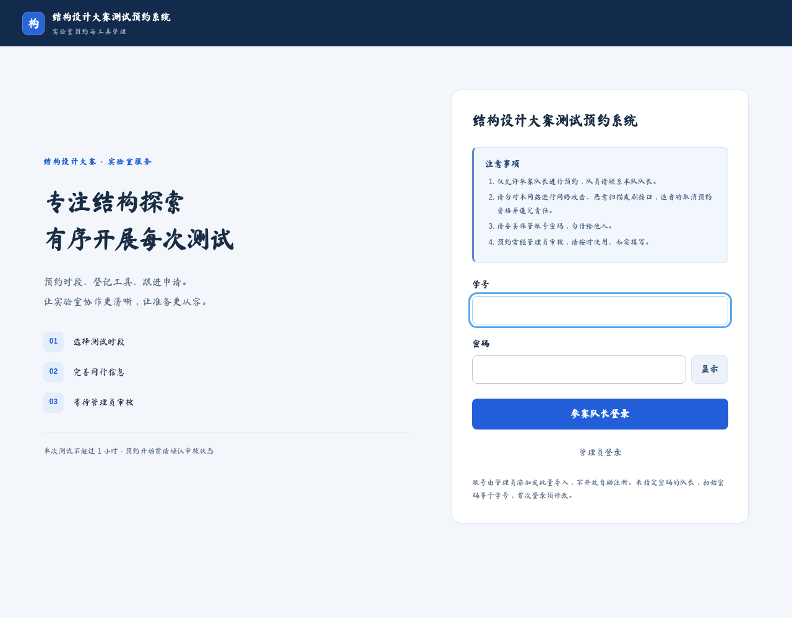
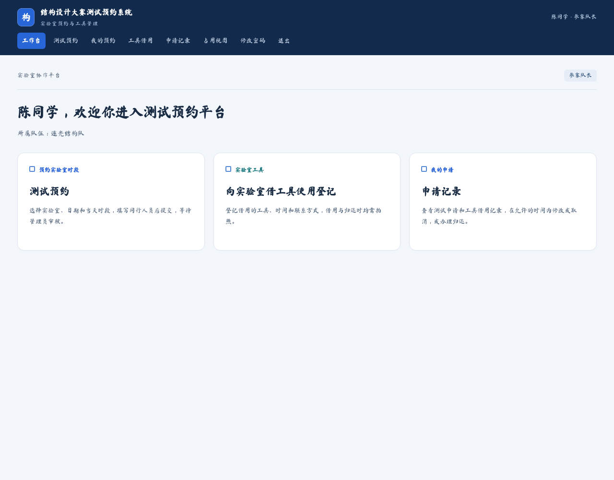
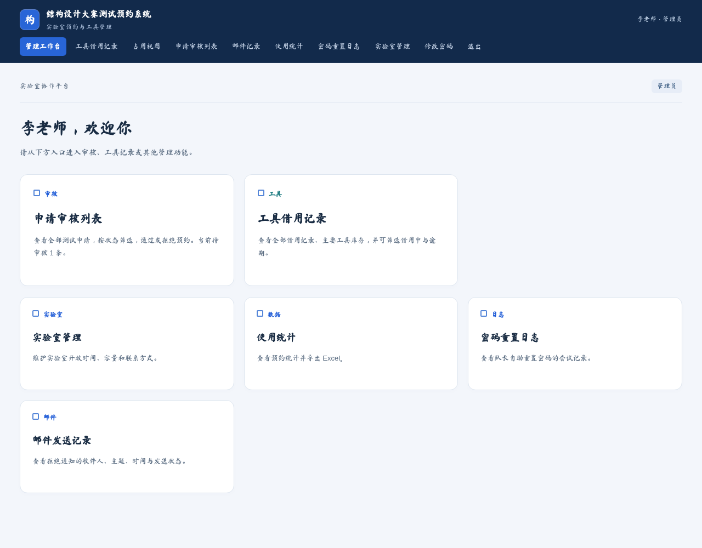

# Club Lab Booking System

[简体中文](README.zh-CN.md)

A Flask and SQLite system for club membership and laboratory booking. Team captains (and specially approved accounts) sign in to book a lab, register tool loans, and collect or buy materials. Administrators review bookings and tool records. The super admin maintains people, administrator accounts, the audit log and the block list. There is no self-registration.



## Features

- **Sign-in**: two entrances — Captain login (student ID and password) and a separate Admin login at `/admin/login` (password only). Every password field can be shown or hidden. The “Please note” copy on the login page lives in `app/notices.py`.
- **Test bookings**: pick a lab, date and time, add the people attending, then submit for review. Conflicts and rules are checked first, with week and day occupancy views. Inside the last 30 minutes a booking is locked and cannot be changed or cancelled by the captain.
- **QR check-in**: a printable code at the lab door. Scan, sign in, change the initial password on first login, then return to check-in. Supports a time window, optional location check, missed-check-in reminders and statistics.
- **Tool loans**: a catalog with stock, loan registration, and a return photo. The super admin may confirm a return without a photo; that choice is audited.
- **Materials**: decimal, fraction and mixed-number quantities, stock that cannot be oversold, a per-team limit, and an email code to confirm a purchase. See [docs/MATERIALS_MODULE.md](docs/MATERIALS_MODULE.md).
- **Announcements**: three levels (shown normally, a required dialog after login, or a dialog plus email). Read and acknowledgement status is tracked.
- **People and accounts**: people records, Excel import with a preview, team rosters, administrator management, and required profile plus email verification on first login.
- **Audit and security**: login and action audit, password-reset log, a passive security center (brute force, scanning and injection-like requests), IP and device blocks, and erasure of personal information.
- **Statistics and export**: usage statistics, Excel export, duty shifts and mail delivery records.
- **Feature switches and maintenance**: the super admin can turn modules off individually or show a maintenance page.
- **Languages**: English is the default. Visitors can switch to Simplified Chinese, Traditional Chinese, Japanese, Korean, Spanish, French or German. The choice is stored in the `lang` cookie.
- **Layout**: a compact horizontal navigation bar on desktop. At 900px and below it collapses into a menu. The [offline UI preview](docs/ui-preview/index.html) uses demo data.
- **Performance**: list pages avoid N+1 queries, with composite indexes, hashed static assets and gzip. See [docs/PERFORMANCE.md](docs/PERFORMANCE.md).
- **Clock**: Beijing time by default (`APP_TIMEZONE=Asia/Shanghai`).

| Captain home | Admin home |
| --- | --- |
|  |  |

## Stack

- Python 3, Flask, Flask-Login, Flask-SQLAlchemy, Flask-WTF
- SQLite (`data/app.db`, WAL mode)
- waitress as the production WSGI server (set `USE_FLASK_DEV=1` to use Flask’s development server)
- Jinja2 pages in English by default, plus Simplified Chinese, Traditional Chinese, Japanese, Korean, Spanish, French and German. Desktop uses a compact top navigation bar and multi-column home pages; phones use a collapsed menu, record cards, a day-by-day occupancy list and photo upload
- openpyxl for account import and statistics export
- pytest

## Layout

```
.
├── app/                    application code, templates and static files
├── tests/                  pytest (each run uses its own database in a temp directory)
├── scripts/
│   ├── start_all.sh        start the app in the background (waitress)
│   ├── stop_all.sh         stop the app
│   ├── restart_app.sh      restart the app
│   ├── status.sh           local health check
│   ├── reset_test_data.sh  wipe and recreate the separate test database
│   ├── seed_test_data.py   sample labs, members and bookings (demo data)
│   ├── write_test_accounts.py
│   ├── set_super_admin_password.py
│   ├── check_smtp_login.py
│   └── capture_*.py / benchmark_pages.py  screenshots and performance checks (development)
├── docs/                   documentation, screenshots and the offline preview
├── run.py                  entry point
├── requirements.txt
└── .env.example            example environment variables
```

Runtime data (database, secrets, tokens, PID files, uploads, exports, the local outbox and logs) is created on first start under `data/`, `logs/` and `backups/`. Those paths are gitignored. Do not commit them.

## Roles

| Role | Entrance | Main access |
| --- | --- | --- |
| Super admin (`superadmin`) | Admin login (password only) | People, administrators, login and action audit, blocks, labs, review, statistics, duties, tool catalog, mail log |
| Administrator (`admin`) | Admin login (password only) | Review bookings, tool loans and stock, labs, statistics, mail log, password-reset log. Cannot open the four super-admin modules |
| Team captain (`member`) | Student ID and password | Test bookings, tool loans and returns, own records (change or cancel until 30 minutes before the start), occupancy view |
| Approved member (`approved_member`) | Student ID and password | Bookings only: submit, change and cancel their own requests and view records. Cannot borrow tools or manage a roster |
| Special guest (`special_guest`) | Student ID and password | Same as an approved member (bookings only), and only while the account is valid |

- Administrator passwords must all be different and are issued by the super admin. Five wrong attempts from the same IP at the admin entrance freeze that IP for one minute. Captain login is not affected. Administrators cannot reset a forgotten password themselves.
- A captain with no assigned password starts with the student ID as the password and must change it at first login. A new captain password is at least 6 characters and must include upper case, lower case and a symbol. It cannot match the old password or the student ID.
- The super admin can change their own password in the app. A strong password is recommended but not required. The current password and a confirmation are still required, and the new password cannot match the old one or another administrator’s password.

## Quick start

Python 3.10 or newer.

```bash
python3 -m venv .venv
source .venv/bin/activate
pip install -r requirements.txt
python run.py            # http://127.0.0.1:5050 by default
```

- The first start creates `data/` and random files `data/secret_key`, `data/api_token.txt` and `data/admin_initial_password.txt` (mode 600).
- The initial super-admin account is `admin`. Sign in at Admin login with the password from that file, then change it.
- If port 5050 is taken, `run.py` searches forward for a free port and prints the address. With `APP_PORT_STRICT=1` it exits instead.

Run in the background (the scripts use the project `.venv`):

```bash
bash scripts/start_all.sh
bash scripts/status.sh
bash scripts/stop_all.sh
```

On the public internet, bind the app to localhost and put an HTTPS reverse proxy in front (Nginx, Caddy or a tunnel). Set `PUBLIC_BASE_URL`.

### Super-admin and test-admin passwords

Do not store a real password in a script that outlives the shell history, and do not leave it on the screen. On success the script prints that a password was updated and does not print the value. Run it yourself; do not run it from automation.

```bash
# Super admin only
SUPER_ADMIN_NEW_PASSWORD='…' .venv/bin/python scripts/set_super_admin_password.py

# Also set test captain TEST001 to the same password (skip captain strength rules and the first-login change)
SUPER_ADMIN_NEW_PASSWORD='…' .venv/bin/python scripts/set_super_admin_password.py --also-captain TEST001

# Test administrator only (read from TEST_ADMIN_NEW_PASSWORD; skip strength rules and the first-login change;
# exit with an error if it matches another administrator; on success also write data/test_accounts.txt, mode 600)
TEST_ADMIN_NEW_PASSWORD='…' .venv/bin/python scripts/set_super_admin_password.py --test-admin testadmin

# All three at once (the test admin can be matched by student ID testadmin, the name, or a numeric ID)
SUPER_ADMIN_NEW_PASSWORD='…' TEST_ADMIN_NEW_PASSWORD='…' \
  .venv/bin/python scripts/set_super_admin_password.py --also-captain TEST001 --test-admin testadmin
```

In the account file the test captain’s password line always says that it matches the super-admin password. It does not contain the value.

## Configuration

| Variable or file | Default | Meaning |
| --- | --- | --- |
| `APP_HOST` | `127.0.0.1` | Bind address. Use `0.0.0.0` only behind a reverse proxy |
| `APP_PORT` | `5050` | Preferred port |
| `APP_PORT_STRICT` | empty | Exit if the port is taken when set to `1` |
| `APP_THREADS` | `8` | waitress threads |
| `USE_FLASK_DEV` | empty | Use Flask’s development server when set to `1` |
| `APP_TIMEZONE` | `Asia/Shanghai` | Clock for “now”, “today”, check-in windows, reminders and log times. Independent of the server’s local timezone |
| `SECRET_KEY` | generated into `data/secret_key` on first start | Flask session key |
| `PUBLIC_BASE_URL` | empty | Public origin used in check-in QR codes and mail links |
| `MAIL_HOST` / `MAIL_PORT` / `MAIL_USERNAME` / `MAIL_FROM` / `MAIL_FROM_NAME` | may also be stored in `data/mail_config` | SMTP host, port, username and From address. No password |
| `MAIL_USE_SSL` / `MAIL_USE_TLS` | `data/mail_config` may default to SSL | Port 465 uses SSL |
| `MAIL_PASSWORD_ENV` | `SMTP_AUTH_CODE` | Name of the environment variable that holds the SMTP secret. The secret is never written to a file |
| `SMTP_AUTH_CODE` | environment only | SMTP/IMAP secret inherited from the environment. Do not put it in a script |
| `MAIL_SEND_ENABLED` | `true` after a login check succeeds | Real delivery to non-reserved domains when `true`; otherwise every message stays in the local outbox |
| `MAIL_PROXY_HOST` / `MAIL_PROXY_PORT` | empty / `8080` | Optional HTTP proxy for DNS-over-HTTPS and SMTP CONNECT. Direct connection when the host is empty |
| `MAIL_DOH_URL` | `https://cloudflare-dns.com/dns-query` | Resolve the SMTP host through the proxy |
| `SUPER_ADMIN_NEW_PASSWORD` / `TEST_ADMIN_NEW_PASSWORD` | empty | Read only by `set_super_admin_password.py`. Not written into code or logs |

The session cookie is `lab_session`, HttpOnly, SameSite=Lax. It is marked Secure when the request comes through a local reverse proxy or tunnel with `X-Forwarded-Proto: https` (or an equivalent header). Login IP, rate limits and blocks trust `CF-Connecting-IP` only when the request itself comes from a local proxy or tunnel (`127.0.0.1` / `::1`), then the first `X-Forwarded-For` address. Every other client is recorded as `REMOTE_ADDR`, and spoofed forwarding headers are ignored. Production mode turns debug off, and error pages do not include a traceback.

### Mail

The SMTP secret and passwords are never written into code, the database, logs or `data/mail_config`. The config file stores the host, port, username, From address, and a note that the secret comes from `SMTP_AUTH_CODE`.

- Config path: `data/mail_config` (`data/` is gitignored)
- Real delivery: set `MAIL_SEND_ENABLED=true` in that file, or export the same variable before start. The environment wins.
- Local only: set `MAIL_SEND_ENABLED` to `false`. Rejection notices are written as `.eml` files under `data/outbox/` and shown as a local archive in the mail log.
- Mail to `example.com`, `example.org`, `example.net` and the reserved suffixes `.test`, `.invalid`, `.localhost` and `.example` stays in the local outbox even when real delivery is on.
- If the SMTP host or the secret variable is missing, mail stays local. A send failure does not block a rejection, but it is recorded and shown on the page.
- Connectivity check (connect, authenticate and QUIT; no message is sent):

```bash
.venv/bin/python scripts/check_smtp_login.py
```

The mail log shows recipient, subject, time and status (sent, local archive, or failed). Do not use the system to send real mail to test addresses.

## Test data

The maintenance scripts only touch the separate database `data/testing/app.db`, test photos, the test outbox and `logs/testing/`. They do not clear `data/app.db` and they do not reset passwords in the real database. Re-running the seed and account scripts keeps existing test-account passwords.

```bash
bash scripts/reset_test_data.sh                 # only data/testing and logs/testing
.venv/bin/python scripts/seed_test_data.py       # separate test database only
.venv/bin/python scripts/write_test_accounts.py  # credentials go to data/testing/test_accounts.txt and are not printed
```

The test database is isolated from `data/app.db`. A test captain’s initial password is the student ID and must be changed at first login. Sample addresses use `example.com`. The test database and the screenshot database run in Flask test mode, which refuses real SMTP.

### Screenshots and the offline preview

```bash
.venv/bin/python -m pip install -r requirements-dev.txt
PLAYWRIGHT_BROWSERS_PATH="$PWD/.playwright-browsers" .venv/bin/python -m playwright install chromium
.venv/bin/python scripts/export_ui_preview.py  # no browser; refreshes the offline HTML preview
.venv/bin/python scripts/capture_ui.py         # needs Chromium and a local listening port
```

Screenshot scripts use a temporary database and a random in-memory password. They listen on the loopback address only, do not read the real database, and do not send mail.

## Security center and viewing an administrator password

- The super admin can choose “view password” in administrator management. The password is stored as Fernet ciphertext. The key file is `data/pw_view_key` (mode 600). Every view is audited and the plaintext is not logged. Ordinary administrators cannot view passwords. `set_super_admin_password.py --test-admin` writes that ciphertext and updates `data/test_accounts.txt`.
- Only the super admin can open the security center, and the server checks the role. Detection is passive: brute force, high-rate crawling, path scans, honeypot paths, injection, XSS or traversal-like input, forbidden 403s, CSRF failures and rate limits. The app does not probe, scan or call back to the source address.
- An event stores the time, type, severity, the checked client IP (forwarding headers are trusted only from a local proxy or tunnel), Cloudflare country headers, user agent, device, related account, and a redacted, truncated parameter summary. Location uses Cloudflare headers only. For more detail the page links to `https://ipinfo.io/<ip>`, which an administrator opens themselves.
- Crossing a threshold temporarily blocks the IP or device. Defaults are conservative and can be changed in the app settings. Direct connections from 127.0.0.1 and ::1 are allow-listed. The super admin’s current session IP and device are not auto-blocked.
- The page can filter, block, unblock and export Excel. The home page and navigation show a dot when there is an unread high-severity event. `reset_test_data.sh` deletes security events when it resets the test database and keeps `data/pw_view_key`.

## JSON API

Every route except `GET /api/health` requires:

```
Authorization: Bearer <token>
X-Student-Id: <acting user's student ID>
```

The token is generated on first start and stored in `data/api_token.txt` (mode 600). Read that file yourself. Do not publish the token.

Main routes:

- `GET /api/health` health check (no token)
- `GET /api/labs`, `POST /api/labs`, `GET/PUT/DELETE /api/labs/<id>`
- `GET /api/bookings`, `POST /api/bookings`, `GET/DELETE /api/bookings/<id>` (delete cancels)
- `POST /api/conflicts` conflict and rule check (touching at an endpoint is not a conflict)
- `POST /api/bookings/<id>/approve`, `POST /api/bookings/<id>/reject` (the JSON body may include `reason`)
- `GET /api/stats?start_date=YYYY-MM-DD&end_date=YYYY-MM-DD`
- `GET /api/users`, `POST /api/users` (super admin only)

The API also rejects disabled, expired, or not-yet-changed-password accounts. Only captains and approved accounts can create bookings, and both a phone number and an email are required. Cancellation has the same 30-minute lock and the response includes the duty, reviewer and lab contacts. Changes are audited. JSON text and boolean fields are type-checked. A lab that already has booking or tool history should be disabled, not deleted.

Permissions match the web UI. If a new booking overlaps only a pending request, the API still creates it and returns a `warning`. CSRF is not used on `/api/`; those routes use the bearer token.

## Tests

```bash
pip install -r requirements-dev.txt
python -m pytest -q
```

Tests use a SQLite database in a temporary directory and do not read or write `data/app.db`. Mail is mocked.

## Uninstall

Stop the app and delete the project directory. It does not store data or configuration anywhere else, and it does not change the system firewall, proxy or network settings.

## License

[MIT](LICENSE)
