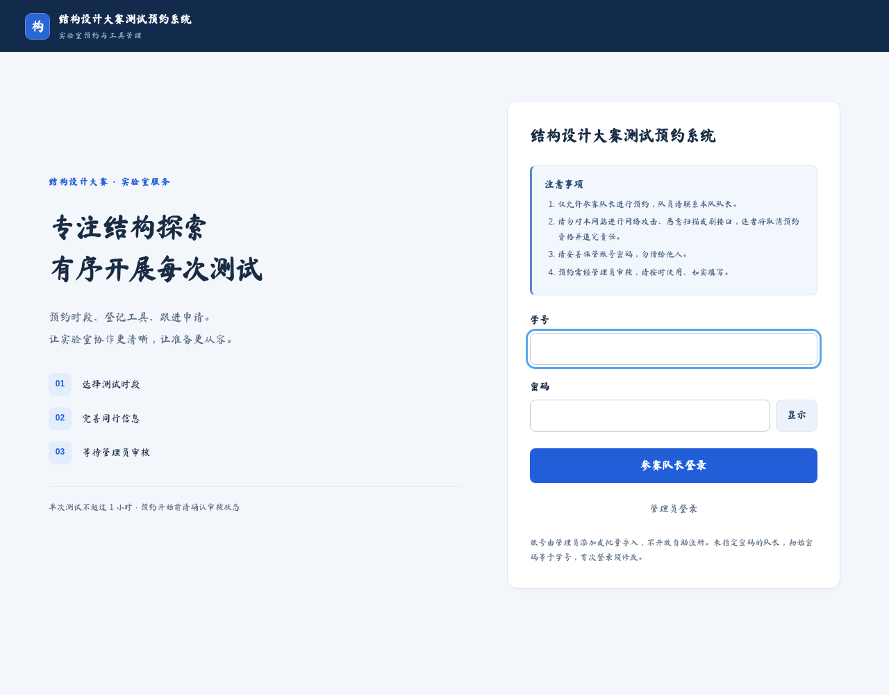
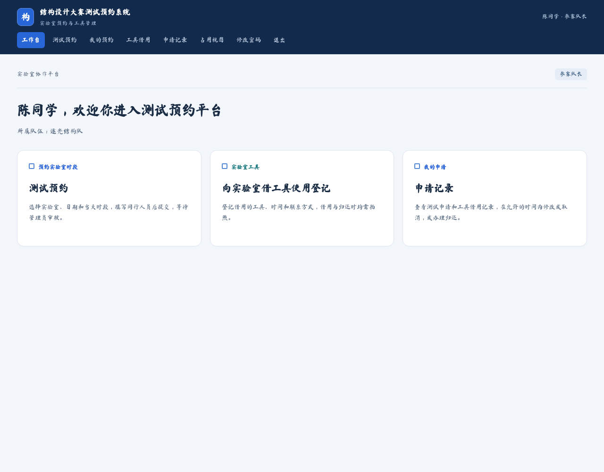
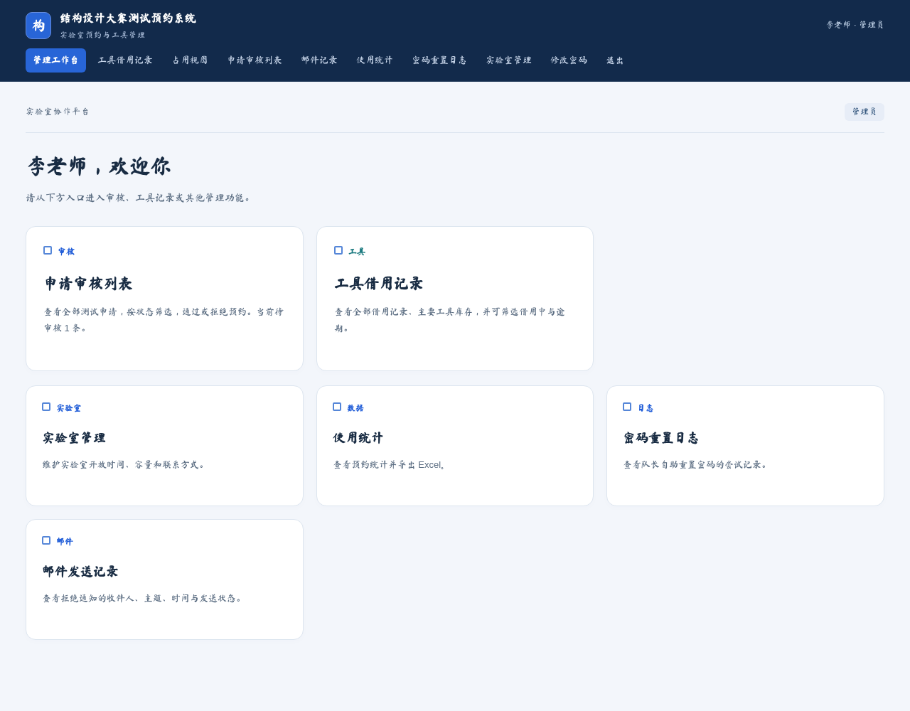

# 社团实验室预约管理系统

[English](README.md)

社团人员管理与实验室使用预约管理系统（Flask + SQLite）。参赛队长（及特批账号）登录后预约实验室、登记工具借用、领取/购买材料；管理员审核预约并查看工具记录；总管理员维护人员、管理员账号、审计与黑名单。不开放自助注册。



## 主要功能

- **登录**：两个入口——「参赛队长登录」（学号 + 密码）和独立的「管理员登录」`/admin/login`（只需密码）。所有密码框支持「显示 / 隐藏」。登录页「注意事项」等文案集中在 `app/notices.py`。
- **测试预约**：选择实验室、日期与时段，填写同行人员后提交，管理员审核；冲突与规则预检，占用视图（周 / 日）。开始前 30 分钟内锁定，不能自行修改或取消。
- **扫码签到**：实验室门口二维码（可打印），扫码 → 登录 →（首次强制改密）→ 自动回到签到页；支持签到时间窗口、可选定位校验、未签到（爽约）提醒与统计。
- **工具借用**：工具清单与库存、借用登记、拍照归还（总管理员确认归还时可免照，记入审计）。
- **材料领取与购买**：支持小数、分数、带分数数量，库存防超卖、每队限领、邮箱验证码确认，详见 [docs/MATERIALS_MODULE.md](docs/MATERIALS_MODULE.md)。
- **公告**：三级公告（普通显示 / 登录强制弹窗确认 / 弹窗 + 邮件通知），阅读与确认情况统计。
- **人员与账号**：人员信息管理、Excel 批量导入（带预览）、队伍花名册、管理员管理、首次登录资料完善与邮箱验证。
- **审计与安全**：登录 / 操作审计、密码重置日志、安全防护中心（被动检测暴力破解、扫描、注入特征等）、IP / 设备拉黑、个人信息清除。
- **统计与导出**：使用统计、Excel 导出、值班安排、邮件发送记录。
- **功能开关与维护模式**：总管理员可单独开关各模块，或开启维护页。
- **多语言**：默认 English，可切换简体中文、繁體中文、日本語、한국어、Español、Français、Deutsch。全站 `lang` cookie 记住选择。
- **界面**：电脑端顶部横向紧凑导航；手机宽度 ≤ 900px 时为折叠菜单。[离线界面预览](docs/ui-preview/index.html) 使用演示数据。
- **性能**：列表预加载避免 N+1 查询、复合索引、静态资源哈希版本与 gzip，测量方法见 [docs/PERFORMANCE.md](docs/PERFORMANCE.md)。
- **时间基准**：默认北京时间（`APP_TIMEZONE=Asia/Shanghai`）。

| 队长工作台 | 管理员工作台 |
| --- | --- |
|  |  |

## 技术栈

- Python 3、Flask、Flask-Login、Flask-SQLAlchemy、Flask-WTF
- SQLite（`data/app.db`，WAL 模式）
- waitress 生产级 WSGI（默认；`USE_FLASK_DEV=1` 时回退到 Flask 开发服务器）
- Jinja2 界面（默认 English，另有简体、繁體、日本語、한국어、Español、Français、Deutsch）：电脑顶部紧凑横向导航、多列工作台；手机折叠菜单、记录卡片、按日占用列表和拍照上传
- openpyxl（账号导入与统计导出）
- pytest 自动化测试

## 目录结构

```
.
├── app/                    应用代码、模板与静态资源
├── tests/                  pytest（使用临时目录中的独立数据库）
├── scripts/
│   ├── start_all.sh        后台启动应用（waitress）
│   ├── stop_all.sh         停止应用
│   ├── restart_app.sh      重启应用
│   ├── status.sh           查看本机健康状态
│   ├── reset_test_data.sh  清空并重建独立测试库
│   ├── seed_test_data.py   写入示例实验室、成员和预约（演示数据）
│   ├── write_test_accounts.py
│   ├── set_super_admin_password.py
│   ├── check_smtp_login.py
│   └── capture_*.py / benchmark_pages.py  截图与性能测量（开发用）
├── docs/                   文档、截图与离线界面预览
├── run.py                  启动入口
├── requirements.txt
└── .env.example            环境变量示例
```

运行时数据（数据库、密钥、令牌、PID、上传 / 导出、本地发件箱、日志）在首次启动时自动创建于项目内的 `data/`、`logs/`、`backups/` 目录，均已在 `.gitignore` 中排除，请勿提交。

## 角色与权限

| 角色 | 登录入口 | 主要权限 |
| --- | --- | --- |
| 总管理员（`superadmin`） | 管理员登录（只输密码） | 人员信息管理、管理员管理、登录/操作审计、拉黑与撤销、实验室、审核、统计、值班、工具清单、邮件记录 |
| 管理员（`admin`） | 管理员登录（只输密码） | 审核预约、查看工具借用与库存、实验室、统计、邮件记录、密码重置日志；不能进入四个总管理模块 |
| 参赛队长（`member`） | 学号 + 密码 | 测试预约、工具借用与归还、申请记录（距开始超过 30 分钟可自行修改/取消）、占用视图 |
| 特批队员（`approved_member`） | 学号 + 密码 | 仅预约：提交/修改/取消自己的测试申请并查看申请记录，不能借工具、不能管理花名册 |
| 特批非参赛（`special_guest`） | 学号 + 密码 | 与特批队员相同（仅预约），并受有效期限制 |

- 管理员密码彼此不得相同，由总管理员下发；同一 IP 在管理员入口连续输错 5 次后冻结 1 分钟（队长入口不受影响）。系统不提供管理员忘记密码自助找回。
- 未指定密码的队长，初始密码等于学号，首次登录须修改。队长新密码至少 6 位，须含大小写字母和特殊符号，且不能与旧密码或学号相同。
- 总管理员在系统内自助改密：建议高强度但不强制；仍须填写当前密码、两次确认，且不能与旧密码或其他管理员密码相同。

## 快速开始

需要 Python 3.10 及以上。

```bash
python3 -m venv .venv
source .venv/bin/activate
pip install -r requirements.txt
python run.py            # 默认 http://127.0.0.1:5050
```

- 首次启动会自动创建 `data/` 目录，并随机生成会话密钥 `data/secret_key`、API 令牌 `data/api_token.txt` 和初始总管理员密码 `data/admin_initial_password.txt`（权限 600）。
- 初始总管理员账号为 `admin`，在「管理员登录」入口使用上述文件中的密码登录，登录后请立即修改。
- 若 5050 端口被占用，`run.py` 会向后寻找空闲端口并打印实际地址；设 `APP_PORT_STRICT=1` 时端口被占用则直接退出。

后台运行（脚本使用项目内 `.venv`）：

```bash
bash scripts/start_all.sh
bash scripts/status.sh
bash scripts/stop_all.sh
```

对公网提供服务时，建议让应用只监听本机，并在前面放置 HTTPS 反向代理（如 Nginx、Caddy 或隧道服务），同时设置 `PUBLIC_BASE_URL`。

### 设置总管理员 / 测试管理员密码

不要把真实密码写进命令历史之外的脚本文件，也不要在终端回显中长期保留。脚本成功时只打印“已更新…密码”，不打印密码值。请自行运行，不要在自动化里执行。

```bash
# 只改总管理员
SUPER_ADMIN_NEW_PASSWORD='…' .venv/bin/python scripts/set_super_admin_password.py

# 同时把测试队长 TEST001 设为与总管理员相同的密码（跳过队长强度、无需首次改密）
SUPER_ADMIN_NEW_PASSWORD='…' .venv/bin/python scripts/set_super_admin_password.py --also-captain TEST001

# 只改测试管理员（从 TEST_ADMIN_NEW_PASSWORD 读取；跳过强度、无需首次改密；
# 若与其他管理员密码相同则报错退出；成功后同步写入 data/test_accounts.txt，权限 600）
TEST_ADMIN_NEW_PASSWORD='…' .venv/bin/python scripts/set_super_admin_password.py --test-admin testadmin

# 一次设置三者（可用学号 testadmin、姓名「测试管理员」或数字 ID）
SUPER_ADMIN_NEW_PASSWORD='…' TEST_ADMIN_NEW_PASSWORD='…' \
  .venv/bin/python scripts/set_super_admin_password.py --also-captain TEST001 --test-admin testadmin
```

测试队长在账号文件中的密码行固定为「密码：同总管理员密码」，不写具体值。

## 配置项（环境变量与文件）

| 变量 / 文件 | 默认值 | 说明 |
| --- | --- | --- |
| `APP_HOST` | `127.0.0.1` | 监听地址（需对外提供服务时设为 `0.0.0.0` 并置于反向代理之后） |
| `APP_PORT` | `5050` | 首选端口 |
| `APP_PORT_STRICT` | 空 | 为 `1` 时端口占用则退出 |
| `APP_THREADS` | `8` | waitress 线程数 |
| `USE_FLASK_DEV` | 空 | 为 `1` 时使用 Flask 开发服务器 |
| `APP_TIMEZONE` | `Asia/Shanghai` | 平台时间基准（北京时间）。所有“现在/今天”、签到窗口、提醒、日志时间都按它计算，与服务器本机时区无关 |
| `SECRET_KEY` | 空则首次启动随机生成并写入 `data/secret_key` | Flask 会话密钥 |
| `PUBLIC_BASE_URL` | 空 | 对外访问地址（用于签到二维码、邮件链接） |
| `MAIL_HOST` / `MAIL_PORT` / `MAIL_USERNAME` / `MAIL_FROM` / `MAIL_FROM_NAME` | 也可写入 `data/mail_config` | SMTP 主机、端口、用户名和发件人（不含密码） |
| `MAIL_USE_SSL` / `MAIL_USE_TLS` | `data/mail_config` 默认可为 SSL | 465 端口使用 SSL |
| `MAIL_PASSWORD_ENV` | `SMTP_AUTH_CODE` | 只从该环境变量读取授权码，不写入任何文件 |
| `SMTP_AUTH_CODE` | （仅环境变量） | SMTP/IMAP 授权码。由当前环境继承，不要写进脚本 |
| `MAIL_SEND_ENABLED` | `true`（登录检查通过后） | 为 `true` 时向非保留域名真实发信；`false` 则一律写入本地发件箱 |
| `MAIL_PROXY_HOST` / `MAIL_PROXY_PORT` | 空 / `8080` | 可选：DoH 解析与 SMTP CONNECT 使用的 HTTP 代理；`MAIL_PROXY_HOST` 为空时直连 |
| `MAIL_DOH_URL` | `https://cloudflare-dns.com/dns-query` | 通过代理解析 SMTP 主机真实 IP |
| `SUPER_ADMIN_NEW_PASSWORD` / `TEST_ADMIN_NEW_PASSWORD` | 空 | 仅供 `set_super_admin_password.py` 读取，不会写进代码或日志 |

会话 Cookie 名称为 `lab_session`，HttpOnly、SameSite=Lax；经本机反向代理/隧道且带 `X-Forwarded-Proto: https`（或等效头）时自动加 Secure。登录 IP、限流和拉黑只在请求来自本机反向代理/隧道（`127.0.0.1` / `::1`）时信任 `CF-Connecting-IP`，其次才是 `X-Forwarded-For` 的第一个地址；其它来源一律使用 `REMOTE_ADDR`，忽略伪造头。生产环境关闭 debug，错误页不返回堆栈。

### 邮件发送说明

系统不会把授权码或密码写入代码、数据库、日志或 `data/mail_config`。配置文件只保存主机、端口、用户名、发件人，以及「密码来自环境变量 `SMTP_AUTH_CODE`」这一引用。

- 配置文件路径：`data/mail_config`（项目已 gitignore `data/`）
- 打开真实发送：在 `data/mail_config` 中设置 `MAIL_SEND_ENABLED=true`，或启动前设置同名环境变量。环境变量优先于文件。
- 关闭真实发送：将 `MAIL_SEND_ENABLED` 设为 `false`，拒绝通知只会写成 `data/outbox/` 下的 `.eml` 并在「邮件发送记录」中显示为「本地存档」。
- 发往 `example.com`、`example.org`、`example.net` 以及 `.test`、`.invalid`、`.localhost`、`.example` 等保留域名的邮件，即使已打开真实发送，也一律只存本地发件箱。
- 未配置 SMTP 主机或未设置授权码环境变量时，自动进入本地发件箱模式。发送失败不会阻断「拒绝」操作，但会记入发送记录并在页面提示。
- 登录连通性检查（只做连接、登录和 QUIT，不发送邮件）：

```bash
.venv/bin/python scripts/check_smtp_login.py
```

后台可以在「邮件发送记录」查看收件人、主题、时间与状态（已发送 / 本地存档 / 失败）。请勿用系统给测试邮箱发送真实邮件。

## 测试数据与清理

维护脚本仅操作独立测试库 `data/testing/app.db`、测试照片/发件箱和 `logs/testing/`，不会清理 `data/app.db`，也不会重设正式库中账号的密码。重跑种子与测试账号脚本会保留已有测试账号密码。

```bash
bash scripts/reset_test_data.sh                 # 只清理 data/testing 和 logs/testing
.venv/bin/python scripts/seed_test_data.py       # 仅写入独立测试库
.venv/bin/python scripts/write_test_accounts.py  # 凭据仅写入 data/testing/test_accounts.txt，不打印
```

测试库与正式数据库 `data/app.db` 隔离，上述脚本不改变正式数据。测试队长的初始密码等于学号，首次登录须修改；示例邮箱均使用 `example.com`。测试库和截图演示库均启用 Flask 测试模式，禁止真实 SMTP 发送。

### 截图与离线预览（开发用）

```bash
.venv/bin/python -m pip install -r requirements-dev.txt
PLAYWRIGHT_BROWSERS_PATH="$PWD/.playwright-browsers" .venv/bin/python -m playwright install chromium
.venv/bin/python scripts/export_ui_preview.py  # 无需浏览器，更新离线 HTML 预览
.venv/bin/python scripts/capture_ui.py         # 需要能启动 Chromium 并监听本机端口
```

截图脚本使用项目内临时数据库和随机内存密码，只监听回环地址，不读取正式数据、不发送邮件。

## 安全防护中心与管理员密码查看

- 总管理员可在「管理员管理」中点击「查看密码」。密码以 Fernet 密文保存在数据库中，密钥文件为 `data/pw_view_key`（权限 600）。每次查看都会写入审计日志，且不记录明文。普通管理员不能查看。脚本 `set_super_admin_password.py --test-admin` 设置测试管理员密码时会同步写入该密文，并更新 `data/test_accounts.txt`。
- 「安全防护中心」仅总管理员可进入（后台校验）。系统只做被动检测和记录：暴力破解、高频爬取、路径扫描、蜜罐路径、注入/XSS/穿越特征、越权 403、CSRF 失败和频率超限。**不会**主动探测、扫描或回连来源地址。
- 事件记录包含时间、类型、级别、经校验的真实 IP（仅信任来自本机反向代理/隧道的 `CF-Connecting-IP` / `X-Forwarded-For`）、Cloudflare 国家等请求头、UA、设备、关联账号和经过脱敏截断的参数摘要。地理位置只使用 Cloudflare 头；如需更多 IP 资料，页面提供 `https://ipinfo.io/<ip>` 外链，由管理员自行打开。
- 超过阈值时会自动临时拉黑 IP/设备（默认可在应用配置中调整，默认较保守）。127.0.0.1 / ::1 本机直连默认白名单；总管理员当前会话的 IP 和设备不会被自动拉黑。
- 页面可筛选、一键拉黑/解除、导出 Excel 取证。首页和导航在出现未读高危事件时显示红点。`reset_test_data.sh` 清库时会一并删除安全事件，但保留 `data/pw_view_key`。

## JSON REST API

除 `/api/health` 外，均需请求头：

```
Authorization: Bearer <令牌>
X-Student-Id: <操作用户学号>
```

令牌在首次启动时随机生成，保存在 `data/api_token.txt`（权限 600）。请自行读取该文件，不要把令牌写入公开材料。

主要接口：

- `GET /api/health` 健康检查（无需令牌）
- `GET /api/labs`、`POST /api/labs`、`GET/PUT/DELETE /api/labs/<id>`
- `GET /api/bookings`、`POST /api/bookings`、`GET/DELETE /api/bookings/<id>`（删除即取消）
- `POST /api/conflicts` 冲突与规则预检（首尾相接不算冲突）
- `POST /api/bookings/<id>/approve`、`POST /api/bookings/<id>/reject`（JSON 体可含 `reason`）
- `GET /api/stats?start_date=YYYY-MM-DD&end_date=YYYY-MM-DD`
- `GET /api/users`、`POST /api/users`（仅总管理员）

API 同样拒绝停用、过期或尚未首次改密的账号；仅队长和特批账号能创建预约，手机号和邮箱均必填。取消同样受开始前 30 分钟锁定限制，并返回值班/审核/实验室联系人。变更写入操作审计，JSON 文本/布尔字段类型有明确校验。实验室有预约历史或工具记录时应停用，不能删除历史证据。

角色权限与网页端一致。提交预约时若仅与待审核记录重叠，接口仍会创建并在响应中给出 `warning`。CSRF 对 `/api/` 豁免，改走 Bearer 令牌。

## 自动化测试

```bash
pip install -r requirements-dev.txt
python -m pytest -q
```

测试使用临时目录中的独立 SQLite 数据库，不读写 `data/app.db`；发信测试使用 mock。

## 卸载

停止服务后删除整个项目目录即可，本项目不会在系统其他位置留下数据或配置，也不会改动系统防火墙、代理或网络设置。

## 许可证

[MIT](LICENSE)
